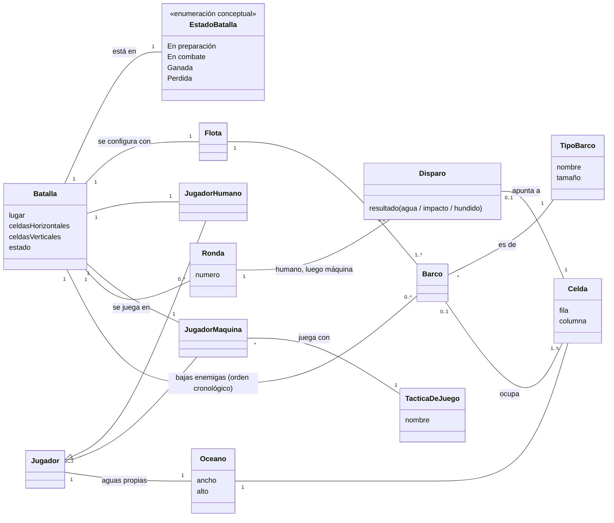
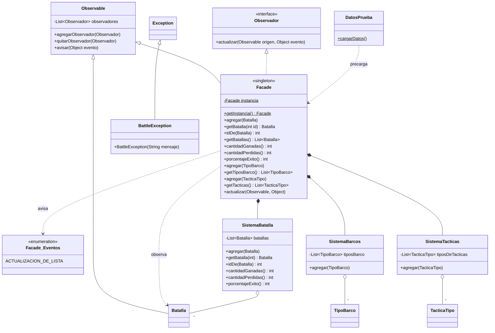
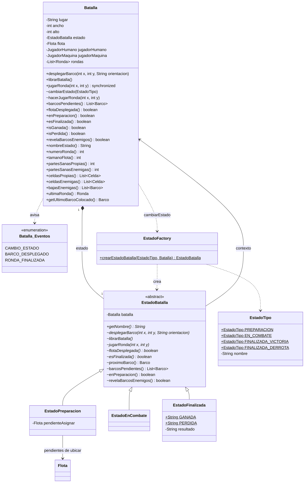
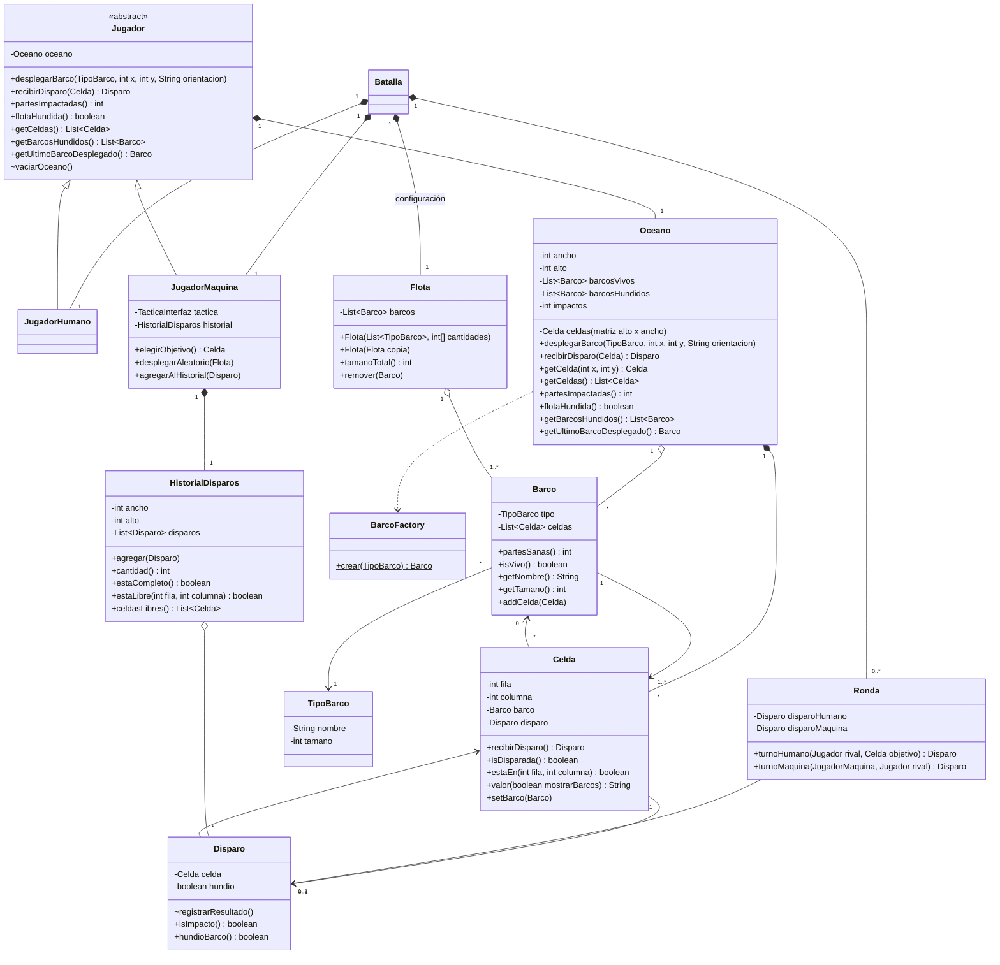
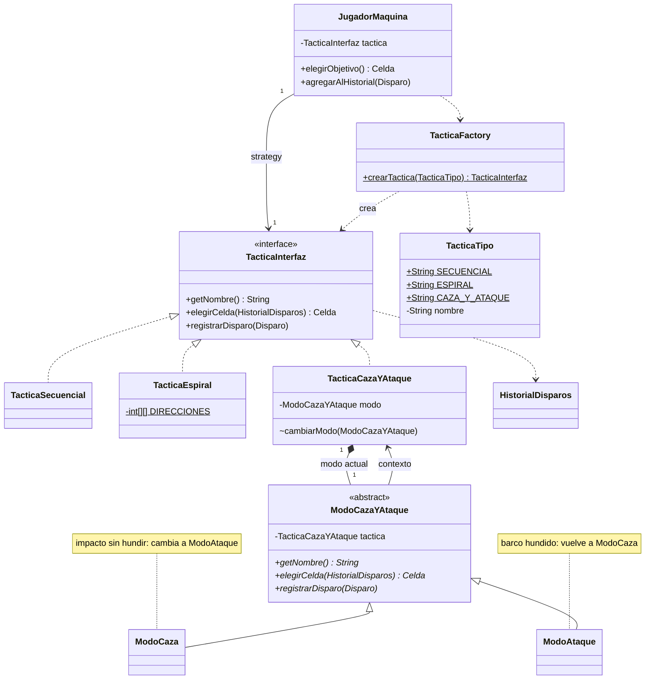
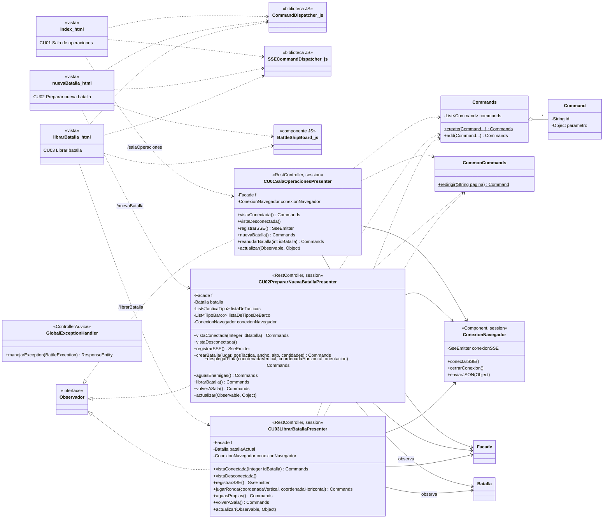
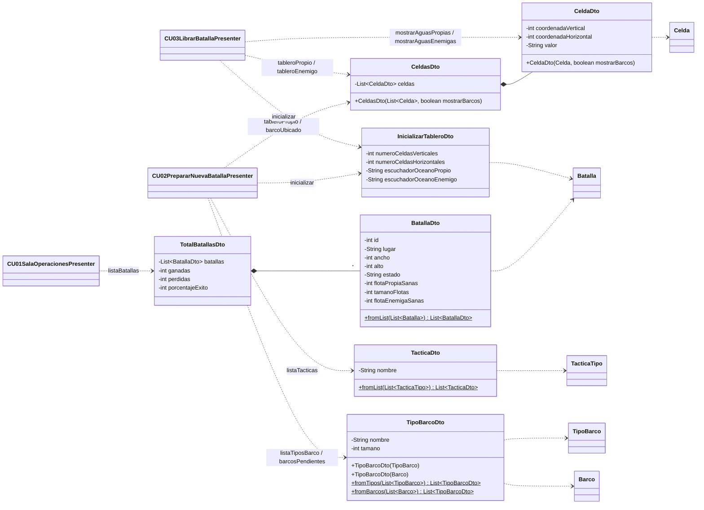

# BattleShip — Batalla Naval

Obligatorio de Diseño de Aplicaciones (ORT, septiembre 2026). Spring Boot + MVP (vista pasiva) + SSE.

Ejecutar: `./mvnw spring-boot:run` y abrir `http://localhost:8080/`.

Los diagramas de abajo son el punto de partida para armar los `.asta` en Astah. Reflejan el código actual.

---

## 1. Diagrama conceptual del dominio

Solo conceptos del problema y sus atributos, sin métodos ni clases técnicas.

---

## 2. Diagrama de diseño — Modelo

### 2.1 Fachada, sistemas y Observer

### 2.2 Batalla y patrón State

### 2.3 Jugadores, océano, flota y disparos

### 2.4 Tácticas: Strategy + cambio dinámico de modo (Caza y ataque)

---

## 3. Diagrama de diseño — Presentación (MVP, vista pasiva + SSE)

### 3.1 DTOs (un DTO por comando, datos justos)

### Comandos por presentador

| Presentador | Comando | Parámetro |
|---|---|---|
| CU01 | `listaBatallas` | `TotalBatallasDto` |
| CU02 | `listaTacticas` | `List<TacticaDto>` |
| CU02 | `listaTiposBarco`, `barcosPendientes` | `List<TipoBarcoDto>` |
| CU02 | `habilitarFormulario` | `boolean` |
| CU02 / CU03 | `lugarBatalla` | `String` |
| CU02 / CU03 | `inicializar` | `InicializarTableroDto` |
| CU02 / CU03 | `tableroPropio` | `CeldasDto` |
| CU02 | `barcoUbicado` | `CeldasDto` |
| CU02 | `confirmarBatallaLista` | `String` (lugar) |
| CU03 | `estadoBatalla` | `String` |
| CU03 | `numeroRonda` | `int` |
| CU03 | `tableroEnemigo` | `CeldasDto` |
| CU03 | `mostrarAguasPropias`, `mostrarAguasEnemigas` | `CeldaDto` |
| CU03 | `bajasEnemigas` | `String` (`{4} {1} {2}`) |
| todos | `redirigir` | `String` (URL) |
